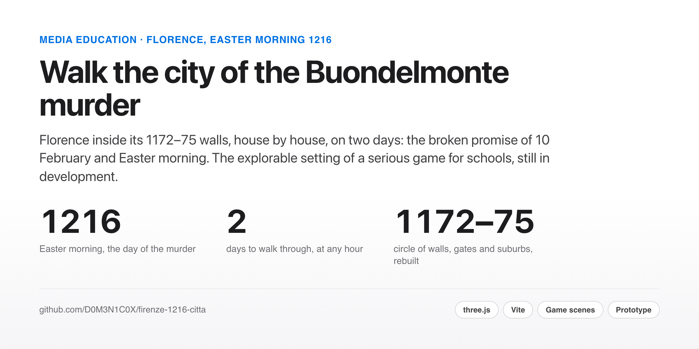

<picture>
  <source media="(prefers-color-scheme: dark)" srcset="site-assets/cover-dark.png">
  
</picture>

<p align="center">
  <a href="https://d0m3n1c0x.github.io/firenze-1216-citta/"><b>Walk the city</b></a> ·
  <a href="PIANO.md">The plan (Italian)</a> ·
  <a href="README.it.md">Italiano</a>
</p>

# Florence, 1216: the city

Florence on Easter morning 1216, to walk through on foot. It is the explorable part of *Cosa fatta capo ha*, a
serious game for schools in development: the game tells the story of the murder of Buondelmonte de' Buondelmonti,
the event the chronicles take as the start of Guelphs and Ghibellines; the city shows the places. The class writes
the chronicle as a young notary, then compares it with the chronicles that survive.

It needs a computer or tablet with a good graphics card: the model is built for high-end hardware, and the first
opening takes a few tens of seconds.

**Prototype** (October 2026): the whole city inside the 1172–75 walls, house by house, with walls, gates and the
suburbs outside them; photographic textures and animated people. Two days: **10 February**, the broken promise, and
**Easter morning**, the murder. On 10 February the city is at work: food stalls in the Old Market, money
changers at their tables, cloth merchants in via Calimala, a smithy near the Santa Maria gate, notaries at their
desks, each with its own sound; on Easter morning the market is empty. The **story mode** leads from scene to scene of the game, each in its place. The
January 1216 banquet is a separate place, the Mazzinghi castle at Campi. The full plan, with phases, sources, calendar
and risks, is in [PIANO.md](PIANO.md).

## Made for anyone

It is designed to be used without a keyboard and on an iPad. At the start you choose between a **guided visit** (ten
stops, from the Buondelmonte house to the walls) and **exploring alone**.

| | |
|---|---|
| **Tap or click the street** | walk there, turning corners on your own |
| **Drag** | look around |
| **From above** (F) | a view over the roofs; tap a point to fly there |
| **What is certain** (C) | colours everything by how much we know about it |
| **Story** (R) | the game's scenes, in their places |
| **Go to…** | the list of places, each with its card and sources |
| **Settings** | the day (10 February or Easter), lighter or richer images, larger text, reduced motion |

Every scene of the game has a link (`?scena=IV3` opens the voices on the bridge), and `npm run verifica` checks, on
every change, that each place can be reached on foot and each scene has a walkable point of view.


A small **map** in the corner shows where you are; tap it to open the full plan and tap a place to go there. The stops of the visit and the place cards can be **read aloud** with the device's voice, and the visit ends with **four questions for the class**. The city is in **Italian and English** (Settings, or `?lang=en`): buttons, visit, questions and cards; the game's story mode is Italian only for now.
## What it is not

- **Not validated yet.** No medievalist has seen it.
- **The houses are generated by the program.** Only the churches and the named towers have the plan of a real
  building.
- **The murder is not shown.** The model shows the place, not the killing.
- **The story comes from a draft script**, not yet reviewed by a medievalist.
- **The walls are rebuilt on today's streets**, which keep their line; heights, battlements and gate towers are
  hypotheses. On the south side, towards the Arno, we do not know where they ran: turn on "What is certain" to see both
  possibilities.

## Run it

```bash
npm install
npm run dev          # then open http://localhost:5216
npm run verifica     # every place reachable, every scene walkable
```

## Licences and credits

Code under MIT ([LICENSE](LICENSE)); texts, cards and script texts under CC BY 4.0
([LICENSE-CONTENUTI.md](LICENSE-CONTENUTI.md)); map data © OpenStreetMap contributors (ODbL 1.0); photographic
textures from Poly Haven (CC0); figures from MakeHuman (CC0) with motion from the CMU Graphics Lab Motion Capture
Database; horses, mules and donkeys from Lyndon Daniels' "Rigged Horse" (CC0). Every source and level of certainty is
listed in [README.it.md](README.it.md#licenze-e-attribuzioni) and in the `FONTI.md` files under `strumenti/`. To cite:
[CITATION.cff](CITATION.cff).

## About

Built by **Domenico Perroni**: HR advisory and people analytics, with a master's in media education, based in Kraków.
[GitHub](https://github.com/D0M3N1C0X) · [LinkedIn](https://www.linkedin.com/in/domenico-perroni) · [Portfolio](https://d0m3n1c0x.github.io/)
